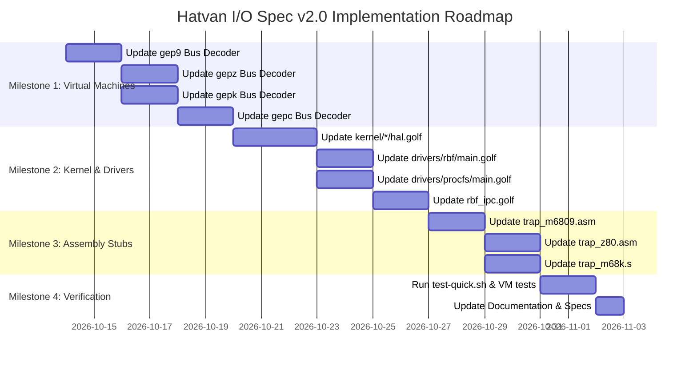

# Hatvan Unified Hardware I/O Architecture Specification (v2.0)
## 32-Bit Addressing, Natural Alignment, and Unified Architecture

**Design Specification & Implementation Roadmap for Hatvan Operating System Virtual Machines & Discrete Hardware**  
*Covers Motorola 6809 / Hitachi 6309 (`gep9`), Zilog Z80 (`gepz`), RCA/COSMAC 1802 (`gepc`), and Motorola 68000 (`gepk`)*

---

## 1. Executive Summary & Design Principles

The Hatvan Operating System hardware I/O architecture v2.0 establishes a completely uniform, cross-architecture peripheral and MMU interface across both 8-bit small-memory processors and 16/32-bit large-memory processors.

This redesign eliminates previous architecture-specific divergences (such as the 68000’s $16 \times \text{offset}$ port spacing) and standardizes on the following core principles:

1. **Identical 1:1 Byte Offsets Across All CPUs**:
   Every register offset (`+$00` through `+$47`) is **100% identical** across M6809, Z80, COSMAC 1802, and M68000.
   - **Small-Memory Platforms (6809, Z80, 1802)**: Base address = **`$FF00`** (`$FF00..$FF47`)
   - **Large-Memory Platforms (68000)**: Base address = **`$00FF0000`** (`$00FF0000..$00FF0047`)
   - The obsolete rule multiplying 68000 I/O offsets by 16 is completely retired.
2. **Unified 32-Bit Composite Memory Pointers (`TAddr32`)**:
   All task-relative memory pointers (for DMA source, DMA destination, disk target buffers, and shared memory boundaries) use a standardized 32-bit composite format combining an **8-bit Task ID** in the high byte and a **24-bit Task Memory Address** in the low 24 bits.
3. **Strict Big-Endian Standard**:
   All multi-byte I/O registers (32-bit composite addresses, 32-bit LSNs, 32-bit DMA counts) are strictly **Big-Endian** on the hardware bus. Z80 and other little-endian CPUs access multi-byte registers MSB-first.
4. **Natural 4-Byte Alignment**:
   Every 32-bit register is aligned on a 4-byte boundary (`+$14`, `+$18`, `+$24`, `+$28`, `+$2C`, `+$30`). The 68000 can access them using atomic `MOVE.L` instructions without risking hardware address error exceptions.
5. **Turbo9Sim Binary Compatibility**:
   Single-byte registers at offsets `+$00..+$05` (`Term.Out`, `Term.In`, `Reg.Stat`, `Reg.Ctrl`, `logchar`, `Exit.Code`) are strictly 1 byte wide, preserving 1:1 compatibility with Boisy Pitre's Turbo9Sim specification.
6. **Decoupled DMA Triggering**:
   Setting transfer parameters does not initiate a DMA transfer as a side effect. Transfers are explicitly commanded by writing `1` to `DMA.CmdSt` (`+$21`).

---

## 2. Unified 32-Bit Composite Address Format (`TAddr32`)

```
 31             24 23             16 15              8 7               0
+-----------------+-----------------+-----------------+-----------------+
|   Task ID (8)   |   AddrHi (8)    |   AddrMid (8)   |   AddrLo (8)    |
+-----------------+-----------------+-----------------+-----------------+
|<-- Task: 8b --->|<---------------- Address: 24b --------------------->|
```

### Field Definitions
- **`Task ID` (`bits [31..24]`, 8 bits)**:
  Target Task selector (`0..255`).
  - Task 0 = Kernel
  - Task 1 = RBF Filesystem Driver
  - Task 2 = PROCFS Driver
  - Tasks 3..255 = User processes
- **`AddrHi` (`bits [23..16]`, 8 bits)**:
  Upper byte of the 24-bit task address space. **Must be `0x00` on non-EMBIGGEN'ed 16-bit systems**.
- **`AddrMid` (`bits [15..8]`, 8 bits)**:
  Middle byte of the 24-bit task address space (bits 15..8 of standard 16-bit address).
- **`AddrLo` (`bits [7..0]`, 8 bits)**:
  Low byte of the 24-bit task address space (bits 7..0 of standard 16-bit address).

### Architectural Interpretation
1. **Non-EMBIGGEN'ed 16-bit Systems (Standard Flat 64KB)**:
   - `AddrHi` (`bits [23..16]`) is fixed to `0x00`.
   - `AddrMid:AddrLo` (`bits [15..0]`) represents the 16-bit task address (`0x0000..0xFFFF`).
   - *Example*: Task 4, buffer at `$0800` $\implies$ `0x04000800`.
2. **EMBIGGEN'ed 16-bit Systems (Paged 8KB Windows into 256 Blocks = 2 MB)**:
   - For direct hardware DMA and Disk streaming, the 24-bit address directly indexes the task's 256 physical 8KB blocks:
     - `Addr[23..13]` (11 bits): Physical 8KB block index (`0..255`).
     - `Addr[12..0]` (13 bits): Byte offset within the 8KB block (`0..8191`).
   - Addresses `0x000000..0x00FFFF` (`AddrHi == 0`) correspond directly to blocks 0..7 under default MMAP `{0, 1, 2, 3, 4, 5, 6, 7}`.
3. **Motorola 68000 (`gepk`)**:
   - `Addr[23..0]` directly addresses 24-bit physical RAM within `Bus.Tasks[Task]`.
   - A single 32-bit instruction (`move.l d0, $00FF0024`) atomically configures both task and destination memory pointer.

---

## 3. Master Hardware Register Map (v2.0)

Registers are organized into functional 16-byte groups with strict 4-byte natural alignment for multi-byte quantities.

| Offset | 6809 / Z80 / 1802 | 68000 (`gepk`) | Register Name | Width | R/W | Description |
| :--- | :--- | :--- | :--- | :---: | :---: | :--- |
| **Console & System Control** | | | | | | *(Turbo9Sim Binary Compatible)* |
| `+$00` | `$FF00` | `$00FF0000` | `Term.Out` | 1 B | W | Console putchar (writes ASCII character to stdout) |
| `+$01` | `$FF01` | `$00FF0001` | `Term.In` | 1 B | R | Console getchar (non-blocking ASCII character, 0 = empty) |
| `+$02` | `$FF02` | `$00FF0002` | `Reg.Stat` | 1 B | R/W | Status (Bit 0 = `Timer.Ready`, Bit 1 = `Term.RxReady`) |
| `+$03` | `$FF03` | `$00FF0003` | `Reg.Ctrl` | 1 B | R/W | IRQ Enable (Bit 0 = `TimrIRQ`, Bit 1 = `TermIRQ`) |
| `+$04` | `$FF04` | `$00FF0004` | `logchar` | 1 B | W | Diagnostic trace output (written directly to stderr) |
| `+$05` | `$FF05` | `$00FF0005` | `Exit.Code` | 1 B | W/R | VM halt termination exit code |
| `+$06..+$0F`| `$FF06..$FF0F`| `$00FF0006..` | *Reserved* | 10 B | - | Reserved for system timer / CPU frequency control |
| **Disk Subsystem** | | | | | | |
| `+$10` | `$FF10` | `$00FF0010` | `Disk.Drive` | 1 B | R/W | Drive unit selector (`0..3` for `/d0` through `/d3`) |
| `+$11` | `$FF11` | `$00FF0011` | `Disk.CmdSt` | 1 B | R/W | Cmd: 1=Read, 2=Write; Status: 0=Busy, 1=OK, >1=Error |
| `+$12..+$13`| `$FF12..$FF13`| `$00FF0012..` | *Reserved* | 2 B | - | Alignment padding to 4-byte boundary |
| `+$14..+$17`| `$FF14..$FF17`| `$00FF0014` | `Disk.Sector` | 4 B | R/W | 32-bit Logical Sector Number (LSN, Big-Endian) |
| `+$18..+$1B`| `$FF18..$FF1B`| `$00FF0018` | `Disk.Target` | 4 B | R/W | 32-bit `TAddr32` target buffer: `[Task:8][Addr:24]` |
| `+$1C..+$1F`| `$FF1C..$FF1F`| `$00FF001C..` | *Reserved* | 4 B | - | Reserved for multi-sector count / block size |
| **MMU & Fast DMA Engine** | | | | | | |
| `+$20` | `$FF20` | `$00FF0020` | `TaskFuse` / `Task.Active` | 1 B | R/W | Armed Task Switch fuse / Active Task ID |
| `+$21` | `$FF21` | `$00FF0021` | `DMA.CmdSt` | 1 B | R/W | Cmd: 1=Start Transfer; Status: 0=Busy, 1=OK, >1=Error |
| `+$22..+$23`| `$FF22..$FF23`| `$00FF0022..` | *Reserved* | 2 B | - | Alignment padding to 4-byte boundary |
| `+$24..+$27`| `$FF24..$FF27`| `$00FF0024` | `DMA.Src` | 4 B | R/W | 32-bit `TAddr32` source pointer: `[SrcTask:8][SrcAddr:24]` |
| `+$28..+$2B`| `$FF28..$FF2B`| `$00FF0028` | `DMA.Dst` | 4 B | R/W | 32-bit `TAddr32` destination pointer: `[DstTask:8][DstAddr:24]` |
| `+$2C..+$2F`| `$FF2C..$FF2F`| `$00FF002C` | `DMA.Count` | 4 B | R/W | 32-bit transfer byte count (Big-Endian, up to 16 MB) |
| **Task Security & Shared Memory** | | | | | | |
| `+$30..+$33`| `$FF30..$FF33`| `$00FF0030` | `SharedMemoryCurtain` | 4 B | R/W | 32-bit boundary ($0000E000 on 8-bit, $00FE0000 on 68k) |
| `+$34` | `$FF34` | `$00FF0034` | `TaskFlagsTarget` | 1 B | R/W | Target task ID (`0..255`) for capability configuration |
| `+$35` | `$FF35` | `$00FF0035` | `TaskFlagsRegister` | 1 B | R/W | Capability flags for selected task: Bit 0 = `TASK_FLAG_IO` |
| `+$36` | `$FF36` | `$00FF0036` | `PurgeTaskMem` | 1 B | W | Zeroes task RAM and revokes capability flags |
| `+$37..+$3F`| `$FF37..$FF3F`| `$00FF0037..` | *Reserved* | 9 B | - | Reserved |
| **EMBIGGEN MMU** | | | | | | *(User Accessible)* |
| `+$40..+$47`| `$FF40..$FF47`| `$00FF0040..` | `Embiggen MMAP` | 8 B | R/W | 8-byte vector mapping 8KB slots 0..7 to physical blocks |

---

## 4. Subsystem Behavioral Details

### 4.1 Character Console & 60Hz Timer (`+$00..+$05`)
- Exactly preserves Turbo9Sim layout.
- `Reg.Stat` (`+$02`):
  - Bit 0 (`$01`): `Timer.Ready` — asserts on 60Hz timer tick. Writing `1` clears.
  - Bit 1 (`$02`): `Term.RxReady` — asserts when console input is ready. Writing `1` clears.
- `Reg.Ctrl` (`+$03`):
  - Bit 0 (`$01`): `TimrIRQ` — enables timer interrupts.
  - Bit 1 (`$02`): `TermIRQ` — enables console RX interrupts.

### 4.2 Disk Subsystem (`+$10..+$19`)
- Supports direct task-to-task sector streaming without kernel memory bouncing.
- Driver sets:
  - `Disk.Drive` (`+$10`) = Drive number (`0..3`)
  - `Disk.Sector` (`+$14..+$17`) = 32-bit LSN (Big-Endian)
  - `Disk.Target` (`+$18..+$1B`) = 32-bit `TAddr32` (`[TargetTask:8][Addr:24]`)
  - `Disk.CmdSt` (`+$11`) = `1` (Read) or `2` (Write)
- Hardware transfers 256 or 512 bytes directly to/from the target task's memory space and sets `Disk.CmdSt = 1` on success, or an error code $>1$ on failure.

### 4.3 Fast DMA Engine (`+$20..+$2F`)
- Supports memory copies up to 16 MB with true 32-bit byte counts.
- **Explicit Triggering**: Writing parameters does not start DMA. Writing `1` to `DMA.CmdSt` (`+$21`) explicitly starts execution.
- Reads of `DMA.CmdSt` return `0` while busy, `1` upon successful completion, or $>1$ if a task access violation occurred.

### 4.4 EMBIGGEN MMU (`+$40..+$47`)
- Provides eight 8KB windows for 64KB address spaces (Slots 0..7).
- User processes can directly read and write their own MMAP vector at `+$40..+$47` without triggering an `ErrUserAccessTrap`.
- The I/O page at `+$00..+$FF` remains frozen in place regardless of the mapping in Slot 7.

---

## 5. Architectural Code Samples

### Motorola 68000 (`gepk`)
```m68k
; DMA copy 4096 bytes from Task 1 ($002000) to Task 4 ($018000)
move.l  #$01002000, $00FF0024   ; DMA.Src: Task 1, Addr $002000
move.l  #$04018000, $00FF0028   ; DMA.Dst: Task 4, Addr $018000
move.l  #4096,      $00FF002C   ; DMA.Count = 4096 bytes
move.b  #1,         $00FF0021   ; DMA.CmdSt = 1 (Start DMA transfer)
.wait_dma:
tst.b   $00FF0021
beq.s   .wait_dma
```

### Motorola 6809 (`gep9`)
```m6809
; DMA copy 4096 bytes from Task 1 ($2000) to Task 4 (Block 12, offset $0000 -> 24-bit $018000)
ldd     #$0100          ; Task 1, AddrHi = 0
std     $FF24           ; DMA.Src [Task:8, AddrHi:8]
ldd     #$2000          ; AddrMid:AddrLo
std     $FF26           ; DMA.Src [AddrMid:8, AddrLo:8]

ldd     #$0401          ; Task 4, AddrHi = $01
std     $FF28           ; DMA.Dst [Task:8, AddrHi:8]
ldd     #$8000          ; AddrMid:AddrLo = $8000
std     $FF2A           ; DMA.Dst [AddrMid:8, AddrLo:8]

ldd     #0
std     $FF2C           ; DMA.Count Hi16 = 0
ldd     #4096
std     $FF2E           ; DMA.Count Lo16 = 4096

lda     #1
sta     $FF21           ; DMA.CmdSt: Start DMA transfer
.wait_dma:
tst     $FF21
beq     .wait_dma
```

### Zilog Z80 (`gepz` — Big-Endian Standard)
```z80
; Set DMA.Src: Task 1, Addr $002000 (Big-Endian: $01, $00, $20, $00)
ld      hl, 0100h
ld      a, h
ld      (0FF24h), a     ; Task = 1
ld      a, l
ld      (0FF25h), a     ; AddrHi = 0
ld      hl, 2000h
ld      a, h
ld      (0FF26h), a     ; AddrMid = $20
ld      a, l
ld      (0FF27h), a     ; AddrLo = $00

; Set DMA.Dst: Task 4, Addr $004000 (Big-Endian: $04, $00, $40, $00)
ld      hl, 0400h
ld      a, h
ld      (0FF28h), a     ; Task = 4
ld      a, l
ld      (0FF29h), a     ; AddrHi = 0
ld      hl, 4000h
ld      a, h
ld      (0FF2Ah), a     ; AddrMid = $40
ld      a, l
ld      (0FF2Bh), a     ; AddrLo = $00

; Set DMA.Count = 4096 (Big-Endian: $00, $00, $10, $00)
xor     a
ld      (0FF2Ch), a
ld      (0FF2Dh), a
ld      hl, 1000h
ld      a, h
ld      (0FF2Eh), a
ld      a, l
ld      (0FF2Fh), a

; Trigger DMA
ld      a, 1
ld      (0FF21h), a     ; DMA.CmdSt = 1
.wait_dma:
ld      a, (0FF21h)
or      a
jr      z, .wait_dma
```

---

## 6. Tasks and Milestones Roadmap



### Milestone 1: Virtual Machine Bus Decoders
- [ ] **Task 1.1 (`gep9/bus.go`)**:
  - Update I/O port dispatch in `ReadByte` and `WriteByte` to match v2.0 table (`$FF00..$FF47`).
  - Implement 32-bit `Disk.Sector` (`$FF14..$FF17`) and `Disk.Target` (`$FF18..$FF1B`).
  - Implement 32-bit `DMA.Src` (`$FF24..$FF27`), `DMA.Dst` (`$FF28..$FF2B`), and `DMA.Count` (`$FF2C..$FF2F`).
  - Wire `DMA.CmdSt` (`$FF21`) as explicit transfer trigger.
  - Update `gep9/cpu_test.go` unit tests.
- [ ] **Task 1.2 (`gepz/bus.go`)**:
  - Update port dispatch in `ReadByte` and `WriteByte` to match v2.0 table.
  - Ensure multi-byte reads/writes conform to big-endian register layout.
  - Update `gepz/cpu_test.go` unit tests.
- [ ] **Task 1.3 (`gepk/bus.go`)**:
  - Remove $16 \times \text{offset}$ address translation.
  - Map I/O directly at `$00FF0000..$00FF0047`.
  - Support both 8-bit `MOVE.B` and 32-bit `MOVE.L` access to 4-byte aligned registers.
  - Update `gepk/cpu_test.go` unit tests.
- [ ] **Task 1.4 (`gepc/bus.go`)**:
  - Bring COSMAC 1802 VM into compliance with v2.0 I/O table.

### Milestone 2: Kernel & Driver HAL Layer
- [ ] **Task 2.1 (`kernel/*/hal.golf`)**:
  - Update port constants (`PORT_DISKDRV`, `PORT_DISKCMD`, `PORT_DISKSEC`, `PORT_DISKTARGET`, `PORT_DMASRC`, `PORT_DMADST`, `PORT_DMACOUNT`, `PORT_DMACMD`).
  - Implement unified `DMACopy32(srcTask, srcAddr24, dstTask, dstAddr24, count)`.
  - Implement unified `DiskTransfer(drive, lsn, targetTask, targetAddr24, isWrite)`.
- [ ] **Task 2.2 (`drivers/rbf/main.golf`)**:
  - Update mailbox and direct hardware disk/DMA transfers to use `TAddr32`.
- [ ] **Task 2.3 (`drivers/procfs/main.golf`)**:
  - Update procfs DMA transfers to use `TAddr32`.
- [ ] **Task 2.4 (`kernel/common/rbf_ipc.golf`)**:
  - Align mailbox offsets to match 32-bit target address representations.

### Milestone 3: Assembly Trap Handlers & Startup Stubs
- [ ] **Task 3.1 (`kernel/m6809/trap_m6809.asm` & `cstart_m6809.asm`)**:
  - Update DMA register addresses for user stack copying (`SWI2` entry/exit).
- [ ] **Task 3.2 (`kernel/z80/trap_z80.asm` & `cstart_z80.asm`)**:
  - Update DMA register addresses and big-endian writes for user stack copying (`Port 60h / NMI` entry/exit).
- [ ] **Task 3.3 (`kernel/m68k/trap_m68k.s`)**:
  - Update I/O port addresses to new 1:1 offsets (`$00FF00xx`).

### Milestone 4: Verification & Integration Testing
- [ ] **Task 4.1 (`scripts/test-quick.sh`)**:
  - Run comprehensive multi-architecture test suite across Z80, 6809, and 68000.
- [ ] **Task 4.2 (`tests/`)**:
  - Verify cross-task 32-bit DMA transfers, EMBIGGEN block streaming, and disk operations across all architectures.
- [ ] **Task 4.3 Documentation**:
  - Replace [`doc/spec-hatvan-io.md`](file:///home/strick/github.com/strickyak/hatvan-os/doc/spec-hatvan-io.md) with finalized v2.0 specification.
