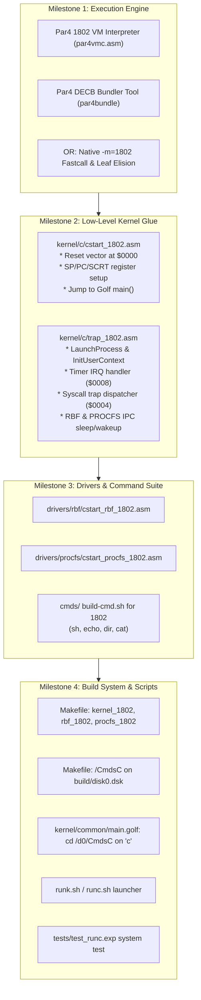

# Hatvan OS on RCA CDP1802 (COSMAC) Implementation Plan & TODO

**Roadmap and Architecture Strategy for Running Hatvan OS and Userspace Commands on the RCA CDP1802 (`gepc`)**

---

## 1. Executive Summary & Current Status

Joining the Motorola 6809 (`gep9`), Motorola 68000 (`gepk`), and Zilog Z80 (`gepz`), the architecture code **`'c'`** designates the RCA COSMAC CDP1802 processor running on the **`gepc`** virtual machine.

### Current Reality Check
1. **Has Hatvan OS ever been booted or launched on the 1802?**
   * **No.** Hatvan OS has never been booted or executed on the 1802 architecture (neither native 1802 machine code nor `par4` bytecode).
2. **Native 1802 Compilation Status**:
   * As analyzed in [`doc/optimizing-1802.md`](file:///home/strick/github.com/strickyak/hatvan-os/doc/optimizing-1802.md), compiling the Golf kernel with `minigolf -m=1802` and assembling with `asm1802` results in a **126 KB** (128,220 bytes) Task 0 binary, and a **61 KB** Task 1 RBF driver.
   * Because the CDP1802 address space is strictly 64 KB (with `$E000..$FEFF` reserved for shared driver curtains and `$FF00..$FFFF` for I/O), Task 0 overflows available RAM by **+130%**, making native unoptimized execution impossible.
3. **Par4 P-Code Status in MiniGolf**:
   * `minigolf` implemented Phase 1 (Go toolchain: `cmd/par4asm`, `cmd/par4dis`, `cmd/par4vmp`) and Phase 2 (`-m=par4` backend in `par4/codegen.go`).
   * However, **Phase 4 (`par4vmc`: the 1802 assembly interpreter engine)** remains an open roadmap item in [`minigolf/doc/par4-language-documentation.md`](file:///home/strick/github.com/strickyak/minigolf/doc/par4-language-documentation.md). Neither `par4vmc.asm` nor `par4bundle` (the DECB bytecode packager) has been created yet.
4. **Why `runc.sh` does not exist yet**:
   * Writing `runc.sh` itself is trivial (a 2-line shell script invoking `gepc`).
   * However, `runc.sh` currently has nothing to execute: there is no bootable 1802 kernel binary, no assembly startup or trap handlers, no 1802 driver stubs, and no userland binaries in `/CmdsC`.

---

## 2. Architectural Choices for 1802 Execution

Due to the 1802's steep **$4.8\times$ code expansion multiplier** compared to orthogonal CISC CPUs like the 6809, two technical pathways exist to fit Hatvan OS into the 1802's memory envelope:

```
+--------------------------------------------------------------------------------+
|                             1802 Execution Paths                               |
+--------------------------------------------------------------------------------+
| Path A: Par4 Virtual Machine (Bytecode)                                        |
|   - 1802 VM Interpreter (`par4vmc.asm`) written once (~2.5 - 3.5 KB).          |
|   - High opcode density (1-byte bytecode instructions).                        |
|   - Ideal for userspace commands (`sh`, `echo`, `dir`, `cat`) and driver tasks. |
|   - Eliminates 1802 register allocation friction for MiniGolf AST.             |
+--------------------------------------------------------------------------------+
| Path B: Optimized Native 1802 Machine Code                                     |
|   - Implement MiniGolf compiler optimizations from doc/optimizing-1802.md:     |
|       * Fastcall calling convention passing args in R(7) and R(8) [-30% size]. |
|       * Leaf function frame elision [-15% size].                               |
|       * Dedicated scratch register for frame offset calculation [-12% size].   |
|       * Out-of-line 16-bit ALU helpers (__add16, __sub16, __cmp16) [-10% size].|
|   - Brings Task 0 Kernel from 126 KB down to ~42-48 KB (< 55 KB limit).        |
+--------------------------------------------------------------------------------+
```

### Recommended Strategy
* **Kernel (Task 0)**: Either native optimized machine code via Path B, or a hybrid native supervisor core.
* **Drivers & Commands (Tasks 1..255)**: Compiled via `par4` bytecode, embedded with `par4vmc` runtime in DECB format, achieving minimum disk and RAM usage.

---

## 3. CDP1802 Hardware & Register Model Reference

Per [`doc/spec-hatvan-1802.md`](file:///home/strick/github.com/strickyak/hatvan-os/doc/spec-hatvan-1802.md):

### 3.1 Register Allocation Matrix
| Register | Native Role | Hatvan OS Function | OS-9 / 6809 Equivalent |
| :---: | :--- | :--- | :---: |
| **$R(0)$** | Reset / DMA Pointer | Hardware DMA Pointer / Reset PC | — |
| **$R(1)$** | Interrupt PC | Hardware Interrupt PC (`/INT`) | — |
| **$R(2)$** | Stack Pointer (`SP`) | Process Stack Pointer (grows down) | **`S`** |
| **$R(3)$** | Program Counter (`PC`) | Main Code Execution PC ($P=3$) | **`PC`** |
| **$R(4)$** | Call Engine Pointer | SCRT Call Routine (`SEP R4`) | — |
| **$R(5)$** | Return Engine Pointer| SCRT Return Routine (`SEP R5`) | — |
| **$R(6)$** | Linkage Register | Subroutine Return Address Linkage | — |
| **$R(7)$** | General Register 7 | **Syscall Buffer / Path Pointer** | **`X`** |
| **$R(8)$** | General Register 8 | **Syscall Byte Count / Length** | **`Y`** |
| **$R(9)$** | General Register 9 | **Syscall Parameter Block Pointer** | **`U`** |
| **$R(\text{A})$** | General Register A | **Syscall Secondary Return Value** | **`B`** |
| **$R(\text{B})$** | General Register B | **Frame Pointer (`FP`)** | — |
| **$R(\text{C})$** | Compiler Temp 0 | Scratch Register | — |
| **$R(\text{D})$** | Compiler Temp 1 | Scratch Register | — |
| **$R(\text{E})$** | Trap Pointer | **Syscall Entry PC (`R_TRAP`)** ($0004) | — |
| **$R(\text{F})$** | Untrap Linkage | **Task Return Fuse (`R_UNTRAP`)** | — |
| **`D`** | Accumulator (8-bit) | **Primary Argument / Return / Status**| **`A`** |
| **`DF`** | Data Flag (1-bit) | **Syscall Error Carry Flag** | **`CC.C`** |

### 3.2 Syscall & Trap Protocol
1. User process sets up registers ($R7$ = buffer/path, $R8$ = count, $D$ = path ID / call number).
2. Syscall triggered by switching PC to $R(\text{E})$ (`SEP RE`) or issuing `OUT 6, D`.
3. Hardware MMU intercepts `OUT 6`, latches opcode in `$FF28`, and switches CPU to Task 0 supervisor mode at `$0004`.
4. Kernel trap handler saves user registers, translates `SyscallFrame`, executes Golf syscall handler, updates $D$/$DF$, and returns to user task via `OUT 7` / `TaskFuse` ($FF20).

---

## 4. Implementation Tasks & Milestones



---

### Milestone 1: Execution Engine & Codegen
- [ ] **1.1 Par4 1802 Engine (`par4vmc.asm`)**:
  - Implement split-page jump table opcode dispatcher.
  - Implement 16-bit evaluation stack in $R(2)$ / $R(\text{B})$.
  - Implement local variable indexing and arithmetic helpers.
  - Implement `HATVAN_TRAP` handler issuing `SEP RE` / `OUT 6`.
- [ ] **1.2 Par4 DECB Bundler (`cmd/par4bundle`)**:
  - Create bundler to concatenate `par4vmc` header stub with `.p4p` bytecode into an executable `.decb` binary.
- [ ] **1.3 Alternative / Complementary Native Compiler Optimizations**:
  - Implement Fastcall argument passing ($R7$, $R8$) in `minigolf -m=1802`.
  - Implement leaf function stack frame elision to eliminate 28-byte overhead per leaf function.

---

### Milestone 2: Kernel Assembly Glue (`kernel/c/`)
- [ ] **2.1 `kernel/c/cstart_1802.asm`**:
  - Reset vector at `$0000`: boot loader initializes $R(2)$ stack to `$DFFF`, sets $R(3)$ as execution PC ($P=3$).
  - Preload SCRT registers ($R(4)$ `CALL`, $R(5)$ `RET`).
  - Preload trap vectors ($R(1)$ hardware IRQ vector `$0008`, $R(\text{E})$ syscall vector `$0004`).
  - Jump to Golf runtime entry point `main()`.
- [ ] **2.2 `kernel/c/trap_1802.asm`**:
  - Implement missing assembly symbols declared in [`kernel/c/hal.golf`](file:///home/strick/github.com/strickyak/hatvan-os/kernel/c/hal.golf):
    - `LaunchProcess(pid, sp, pc)`: Saves kernel state, loads user context, sets TaskFuse ($FF20), enters user space.
    - `InitUserContext(pid, sp, pc)` & `FreeUserContext(pid)`: Per-process register save tables.
    - `RBFCall()` & `ProcfsCall()`: Driver task wakeups and parameter handoffs across Shared Curtain (`$E000`).
    - `Sleep()`: Yields CPU until next interrupt.
  - Hardware Timer Interrupt handler at `$0008` (acknowledges `$FF02`, enforces kernel single-entry rule, invokes `proc.ScheduleNext`).
  - Syscall Trap handler at `$0004` (marshals registers into `SyscallFrame`, executes `syscall.DispatchSyscall`, restores user context).

---

### Milestone 3: Driver Stubs & Userspace Utilities
- [ ] **3.1 RBF Driver Assembly Stub**:
  - Create `drivers/rbf/cstart_rbf_1802.asm` matching `cstart_rbf_m6809.asm` and `cstart_rbf_z80.asm`.
  - Listen on `RBFMailbox` at `$E000` curtain, process disk transfers, call `f_hal__Sleep`.
- [ ] **3.2 PROCFS Driver Assembly Stub**:
  - Create `drivers/procfs/cstart_procfs_1802.asm`.
  - Listen on `ProcfsMailbox` at `$E000` curtain, format `/proc` responses, call `f_hal__Sleep`.
- [ ] **3.3 Userspace Command Suite**:
  - Add 1802 target support to `build-cmd.sh`.
  - Compile `sh`, `echo`, `dir`, `cat`, and test binaries into `.c.decb` executables.

---

### Milestone 4: Build System, Disk Image & System Tests
- [ ] **4.1 `Makefile` Target Additions**:
  - Add rules to assemble/link `build/kernel_1802.decb`.
  - Add rules to assemble/link `build/rbf_1802.decb` and `build/procfs_1802.decb`.
- [ ] **4.2 Disk Directory `/CmdsC`**:
  - Update `make disk` rule to create `/CmdsC` on `build/disk0.dsk` and install all 1802 command binaries.
- [ ] **4.3 Kernel Directory Switching**:
  - In [`kernel/common/main.golf`](file:///home/strick/github.com/strickyak/hatvan-os/kernel/common/main.golf), ensure `chgdir` selects `/d0/CmdsC` when `hal.ARCH == 'c'`.
- [ ] **4.4 `runc.sh` Runner**:
  - Create `runc.sh` with options for `gepc -disk0=build/disk0.dsk -kernel=build/kernel_1802.decb`.
- [ ] **4.5 Automated Expect Test Suite**:
  - Create `tests/test_runc.exp` exercising `echo`, `dir`, `cat /proc/p`, and `exit`.
  - Add `tests/test_runc.exp` to `scripts/test-expect.sh` alongside `test_run9.exp`, `test_runz.exp`, and `test_runk.exp`.
