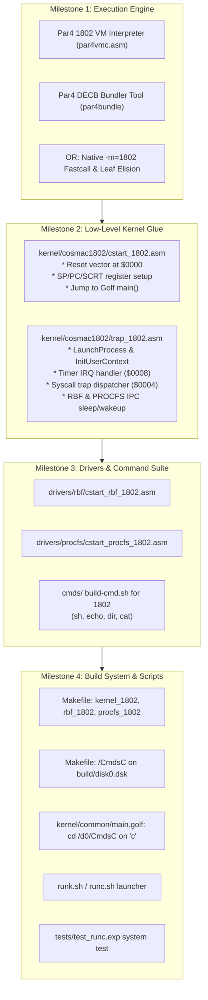

# Hatvan OS on RCA CDP1802 (COSMAC) Implementation Plan & TODO

**Roadmap and Architecture Strategy for Running Hatvan OS and Userspace Commands on the RCA CDP1802 (`gepc`)**

---

## 1. Executive Summary & Current Status

Joining the Motorola 6809 (`gep9`), Motorola 68000 (`gepk`), and Zilog Z80 (`gepz`), the architecture code **`'c'`** designates the RCA COSMAC CDP1802 processor running on the **`gepc`** virtual machine.

### Current Reality Check
1. **Has Hatvan OS ever been booted or launched on the 1802?**
   * **No.** Hatvan OS has never been booted or executed on the 1802 architecture (neither native 1802 machine code nor `par4` bytecode).
2. **Native 1802 Compilation Status**:
   * As analyzed in [`doc/optimizing-1802.md`](file:///home/strick/github.com/strickyak/hatvan-os/doc/optimizing-1802.md), compiling the Golf kernel with `minigolf -m=1802` and assembling with `asm1802` results in a **126 KB** (128,220 bytes) Task 0 binary, and a **61 KB** Task 1 RBF driver.
   * Because the CDP1802 address space is strictly 64 KB (with `$E000..$FEFF` reserved for shared driver curtains and `$FF00..$FFFF` for I/O), Task 0 overflows available RAM by **+130%**, making native unoptimized execution impossible.
3. **Par4 P-Code Status in MiniGolf**:
   * `minigolf` implemented Phase 1 (Go toolchain: `cmd/par4asm`, `cmd/par4dis`, `cmd/par4vmp`) and Phase 2 (`-m=par4` backend in `par4/codegen.go`).
   * However, **Phase 4 (`par4vmc`: the 1802 assembly interpreter engine)** remains an open roadmap item in [`minigolf/doc/par4-language-documentation.md`](file:///home/strick/github.com/strickyak/minigolf/doc/par4-language-documentation.md). Neither `par4vmc.asm` nor `par4bundle` (the DECB bytecode packager) has been created yet.
4. **Why `runc.sh` does not exist yet**:
   * Writing `runc.sh` itself is trivial (a 2-line shell script invoking `gepc`).
   * However, `runc.sh` currently has nothing to execute: there is no bootable 1802 kernel binary, no assembly startup or trap handlers, no 1802 driver stubs, and no userland binaries in `/CmdsC`.

---

## 2. Architectural Choices for 1802 Execution

Due to the 1802's steep **$4.8\times$ code expansion multiplier** compared to orthogonal CISC CPUs like the 6809, two technical pathways exist to fit Hatvan OS into the 1802's memory envelope:

```
+--------------------------------------------------------------------------------+
|                             1802 Execution Paths                               |
+--------------------------------------------------------------------------------+
| Path A: Par4 Virtual Machine (Bytecode)                                        |
|   - 1802 VM Interpreter (`par4vmc.asm`) written once (~2.5 - 3.5 KB).          |
|   - High opcode density (1-byte bytecode instructions).                        |
|   - Ideal for userspace commands (`sh`, `echo`, `dir`, `cat`) and driver tasks. |
|   - Eliminates 1802 register allocation friction for MiniGolf AST.             |
+--------------------------------------------------------------------------------+
| Path B: Optimized Native 1802 Machine Code                                     |
|   - Implement MiniGolf compiler optimizations from doc/optimizing-1802.md:     |
|       * Fastcall calling convention passing args in R(7) and R(8) [-30% size]. |
|       * Leaf function frame elision [-15% size].                               |
|       * Dedicated scratch register for frame offset calculation [-12% size].   |
|       * Out-of-line 16-bit ALU helpers (__add16, __sub16, __cmp16) [-10% size].|
|   - Brings Task 0 Kernel from 126 KB down to ~42-48 KB (< 55 KB limit).        |
+--------------------------------------------------------------------------------+
```

### Recommended Strategy: The Hybrid Task 0 & Common Low-Memory Architecture
* **The Problem**: Native unoptimized compilation of the Golf kernel produces **126 KB** of 1802 machine code, far exceeding the 56 KB available memory below the shared curtain (`$E000`).
* **The Solution**: 
  1. Compile kernel (`main.golf` and all common kernel modules) and driver tasks into compact **`par4` P-Code** bytecode (~17 KB for kernel, ~7 KB for RBF, ~2 KB for PROCFS).
  2. Implement an **Assembly Supervisor Substrate & P-Code Interpreter (`par4vmc.asm`)** residing in a **Common Low-Memory Runtime Template ($0000..$0FFF)**.
  3. **Zero-Cost Context Switching**: The first 4 KB (`$0000..$0FFF`) of memory is **identical across all tasks**. Task 0 initializes this template at boot, and when spawning any new task, clones `$0000..$0FFF` using hardware DMA (`PORT_DMACMD`).
  4. User and driver tasks execute their `.p4p` bytecode starting at **`$1000`**.
  5. Syscall trap (`OUT 6`) and untrap (`OUT 7` / `$FF20`) only need to save and restore 4 task registers ($R2, R5, R6, R7$ = 8 bytes total!).

---

## 3. CDP1802 Hardware & Dedicated Register Model

### 3.1 Common Low-Memory Runtime Map (`$0000..$0FFF`)
```
+---------------+--------+------------------------------------------------------+
| Address Range | Size   | Usage / Contents                                     |
+---------------+--------+------------------------------------------------------+
| $0000..$0003  | 4 B    | Reset Vector / Task 0 Entry (User tasks: F$Exit)      |
| $0004..$0005  | 2 B    | Syscall Trampoline (SEX R3; OUT 6)                   |
| $0006..$0007  | 2 B    | Syscall Kernel Entry (Task 0: LBR _SyscallEntry)     |
| $0008..$000F  | 8 B    | Hardware Interrupt Vector (/INT: LBR _TimerIRQ)      |
| $0010..$003F  | 48 B   | SCRT Standard Call & Return routines (CALL / RET)    |
| $0040..$00FF  | 192 B  | Task Configuration Header & Syscall Parameter Block  |
| $0100..$01FF  | 256 B  | Page-Aligned OpcodeTableLo (par4vmc low jump table)   |
| $0200..$02FF  | 256 B  | Page-Aligned OpcodeTableHi (par4vmc high jump table)  |
| $0300..$0DFF  | 2816 B | par4vmc P-Code Interpreter Core & Opcode Handlers    |
| $0E00..$0FFF  | 512 B  | Low Scratch & Shared MMU / DMA Transfer Buffers       |
+---------------+--------+------------------------------------------------------+
| $1000..$BFFF  | 44 KB  | Task Code & Data (Bytecode *.p4p loaded at $1000)     |
| $C000..$DFFF  | 8 KB   | Native Machine Call Stack (R2 SP grows downward)     |
| $E000..$FEFF  | 7.75KB | Shared Driver Curtain (Task 0, 1, 2 mailboxes)       |
| $FF00..$FFFF  | 256 B  | Hatvan Hardware I/O Page ($FF00..$FF47)              |
+---------------+--------+------------------------------------------------------+
```

### 3.2 Dedicated Register Allocation & Invariant Matrix
| Register | Name / Role | Usage Rules | Task Mode Invariant |
| :---: | :--- | :--- | :--- |
| **$R(0)$** | Hardware DMA / Boot | Hardware DMA and system boot scratch. | **System Reserved** (Do not touch) |
| **$R(1)$** | Interrupt PC | Always points to `$0008` (Hardware `/INT` forces $P=1$). | **System Invariant** (Must remain `$0008`) |
| **$R(2)$** | Native Stack Pointer (`SP`) | Machine call stack, grows down from `$DFFF`. | **Private SP** (Saved on trap/switch) |
| **$R(3)$** | **`R_DISPATCH`** | Interpreter dispatch PC ($P=3$). Loops fetching bytecodes. | **Interpreter Invariant** |
| **$R(4)$** | **`R_EXEC`** | Bytecode execution PC ($P=4$) & SCRT call target. | **Interpreter Invariant** |
| **$R(5)$** | **`R_P4PC`** | Current P-Code Bytecode Program Counter. | **Task State** (Saved on trap/switch) |
| **$R(6)$** | **`R_P4SP`** | Par4 16-bit Operand Stack Pointer (grows down). | **Task State** (Saved on trap/switch) |
| **$R(7)$** | **`R_P4FP`** | Par4 Local Frame Pointer / Syscall Register $X$. | **Task State** (Saved on trap/switch) |
| **$R(8)$** | **`R_STRPOOL`** | Task String Pool Pointer / Syscall Register $Y$. | **Task Constant** |
| **$R(9)$** | **`R_GLOBALS`** | Task Globals Table Pointer / Syscall Register $U$. | **Task Constant** |
| **$R(\text{A})$** | **`R_T0`** | Primary 16-bit evaluation temp / Syscall Register $B$. | Evaluation Scratch |
| **$R(\text{B})$** | **`R_T1`** | Secondary 16-bit evaluation temp. | Evaluation Scratch |
| **$R(\text{C})$** | **`R_TBL_LO`** | Points to `OpcodeTableLo` (`$0100`). High byte fixed at `$01`. | **Table Invariant** (Must remain `$01xx`) |
| **$R(\text{D})$** | **`R_TBL_HI`** | Points to `OpcodeTableHi` (`$0200`). High byte fixed at `$02`. | **Table Invariant** (Must remain `$02xx`) |
| **$R(\text{E})$** | **`R_TRAP`** | Syscall Trap Pointer. Always points to `$0004`. | **System Invariant** (Must remain `$0004`) |
| **$R(\text{F})$** | **`R_SCRATCH`** | Untrap linkage / byte copying / Syscall Untrap Fuse. | System Scratch |
| **`D`** | Accumulator | 8-bit math / Syscall Register $A$ / Path ID / Status. | Working Accumulator |
| **`DF`** | Carry Flag | Error flag on syscall return ($0=\text{OK}, 1=\text{Error}$). | System Status Bit |

---

## 4. Syscall Trap & Untrap Lifecycle

```mermaid
sequenceDiagram
    autonumber
    participant U as User Task N ($1000+)
    participant T as Low Memory ($0004..$0006)
    participant M as Hardware MMU (gepc)
    participant K as Kernel Task 0 (Golf / Hal)

    Note over U: Executing P-Code at R5
    U->>T: Opcode HATVAN_TRAP: SEP RE
    Note over T: Address $0004: SEX R3; OUT 6
    T->>M: OUT 6 strobes port 6 with Syscall ID
    M->>M: Latch $FF60 = ID, CurrentTask = 0
    M->>K: Execution continues in Task 0 at $0006
    Note over K: LBR _SyscallTrapEntry
    K->>K: Save User Task N's R2, R5, R6, R7 in PCB (8 bytes)
    K->>K: Switch to Kernel R2 (SP) and R6 (P4SP)
    K->>K: syscall.DispatchSyscall() handles request
    K->>K: Set return values: D=res_A, DF=err, RA=res_B, R8=res_Y
    K->>K: Restore User Task N's R2, R5, R6, R7 from PCB
    K->>M: Arm TaskFuse: OUT 7 (or write $FF20 with task N)
    K->>U: SEP R3 (MMU flips back to Task N; R3 resumes DispatchNext)
    Note over U: User P-Code interpreter resumes instantly!
```

---

## 5. Implementation Tasks & Milestones



---

### Milestone 1: Execution Engine & Codegen
- [x] **1.1 Par4 1802 Engine (`kernel/cosmac1802/par4vmc.asm`)**:
  - Implement split-page jump table opcode dispatcher.
  - Implement 16-bit evaluation stack in $R(2)$ / $R(\text{B})$.
  - Implement local variable indexing and arithmetic helpers.
  - Implement `HATVAN_TRAP` handler issuing `SEP RE` / `OUT 6`.
- [x] **1.2 Par4 DECB Bundler (`cmd/par4bundle`)**:
  - Create bundler to concatenate `par4vmc` header stub with `.p4p` bytecode into an executable `.decb` binary.
- [x] **1.3 P-Code VM Strategy**:
  - Bytecode density fits kernel, drivers, and userland within 64 KB memory space.

---

### Milestone 2: Kernel Assembly Glue (`kernel/cosmac1802/`)
- [x] **2.1 `kernel/cosmac1802/cstart_1802.asm` / `kernel/cosmac1802/par4vmc.asm`**:
  - Reset vector at `$0000`: boot loader initializes $R(2)$ stack to `$DFFE`, sets $R(3)$ as execution PC ($P=3$).
  - Preload SCRT registers ($R(4)$ `CALL`, $R(5)$ `RET`).
  - Preload trap vectors ($R(1)$ hardware IRQ vector `$0008`, $R(\text{E})$ syscall vector `$0004`).
  - Jump to Golf runtime entry point `main()`.
- [x] **2.2 `kernel/cosmac1802/trap_1802.asm` / `kernel/cosmac1802/par4vmc.asm`**:
  - Implemented assembly symbols declared in [`kernel/cosmac1802/hal.golf`](file:///home/strick/github.com/strickyak/hatvan-os/kernel/cosmac1802/hal.golf):
    - `LaunchProcess(pid, sp, pc)`: Saves kernel state in `kernel_launch_r*_table`, restores user context, sets TaskFuse ($FF20), enters user space.
    - `InitUserContext(pid, sp, pc)` & `FreeUserContext(pid)`: Per-process register save tables.
    - `RBFCall()` & `ProcfsCall()`: Driver task wakeups and parameter handoffs across Shared Curtain (`$E000`).
    - `Sleep()`: Yields CPU until next interrupt.
  - Syscall Trap handler at `$0004` / `$0006` (marshals registers into `SyscallFrame`, executes `syscall.Dispatch`, restores user context).

---

### Milestone 3: Driver Stubs & Userspace Utilities
- [x] **3.1 RBF Driver Assembly Stub**:
  - Integrated with `par4vmc.bin`, listening on `RBFMailbox` at `$E000` curtain, process disk transfers, call `hal.Sleep()`.
- [x] **3.2 PROCFS Driver Assembly Stub**:
  - Integrated with `par4vmc.bin`, listening on `ProcfsMailbox` at `$E000` curtain, format `/proc` responses, call `hal.Sleep()`.
- [x] **3.3 Userspace Command Suite**:
  - Add 1802 target support to `build-cmd.sh`.
  - Compile `sh`, `echo`, `dir`, `cat`, and test binaries into `.c.decb` executables.

---

### Milestone 4: Build System, Disk Image & System Tests
- [x] **4.1 `Makefile` Target Additions**:
  - Add rules to assemble/link `build/kernel_1802.decb`.
  - Add rules to assemble/link `build/rbf_1802.decb` and `build/procfs_1802.decb`.
- [x] **4.2 Disk Directory `/CmdsC`**:
  - Update `make disk` rule to create `/CmdsC` on `build/disk0.dsk` and install all 1802 command binaries.
- [x] **4.3 Kernel Directory Switching**:
  - In [`kernel/common/main.golf`](file:///home/strick/github.com/strickyak/hatvan-os/kernel/common/main.golf), ensure `chgdir` selects `/d0/CmdsC` when `hal.ARCH == 'c'`.
- [x] **4.4 `runc.sh` Launcher**:
  - Created `runc.sh` with options for `gepc -tick-hz=0 -disk0=build/disk0.dsk -task1=build/rbf_1802.decb -task2=build/procfs_1802.decb build/kernel_1802.decb`.
- [x] **4.5 Automated Expect Test Suite**:
  - Created `tests/test_runc.exp` exercising `echo`, `dir`, `cat /proc/p`, and `exit`.
  - Added `-tick-hz=0` to Makefile for 1802 testing.
  - Verified `make test`, `make test-interactive`, and `expect tests/test_runc.exp` all pass with `=== TEST_RUNC: PASS ===`.
